# Three-scene layout refinement

Branch: `feat/aegis-three-scene-layout` · baseline: merged V3 `42d224a` · verified 13 October 2026.

## Changes

- **05 — Hardware:** two original photographs at their intrinsic 3:4 and 4:3 proportions, with unequal widths and no image crop, stretching or zoom. An 8px paper surround preserves all rectangular image corners. Inspection affordances sit below the photographs. The three devices share a compact strip below the gallery. The original evidence note and §3.6.3 figure references remain.
- **10 / 12 — Demonstrations:** one `VideoInsertFrame` leads each scene, at approximately 67.5% of its bounded content row. The 16:9 viewport has browser chrome, a finished missing-recording state, and native MP4 controls when the manifest marks a real recording available. Five numbered, nonmedia steps occupy the right panel. Screenshot manifests and reusable galleries remain available for future use and the assessment evidence dialog.
- **Motion:** the hardware mask reveals the complete original image; hover raises the frame without scaling its contents. Equipment labels and demo steps enter with bounded GSAP stagger. Reduced motion and reading mode skip these entrances. The timeline has no looping animation or fabricated playback progress.
- **Accessibility:** the timeline has an explicit list role and the equipment strip an explicitly named group. Native photo dialogs and video controls keep their existing keyboard behavior.

All 18 scenes, source content, findings, notes, chapter navigation, TH/EN persistence, original branding, 90-second demo slots and the 14:35 speaking budget are preserved. `src/data/content.ts`, `src/data/diagrams.ts` and `src/data/assets.ts` have no changes.

## Before / after — actual browser captures

Each image is 1920×1080. Before captures came from the merged V3 baseline; after captures use the corrected layouts. No screenshot was recreated or edited.

| Scene / language | Before | After |
| --- | --- | --- |
| Hardware · TH | 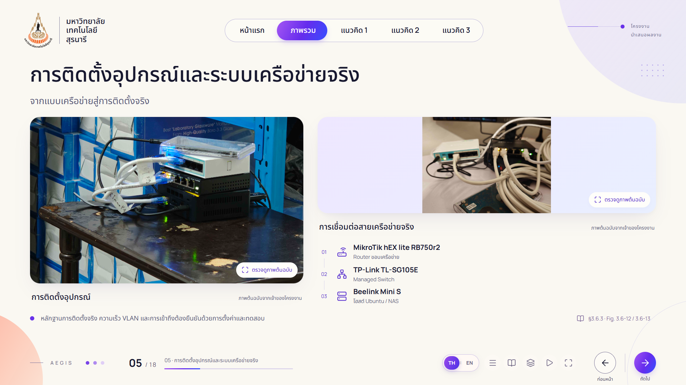 | 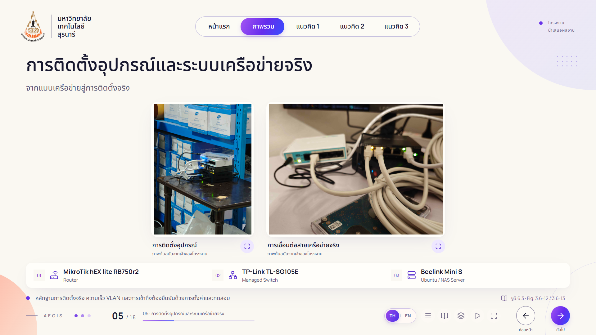 |
| Hardware · EN | 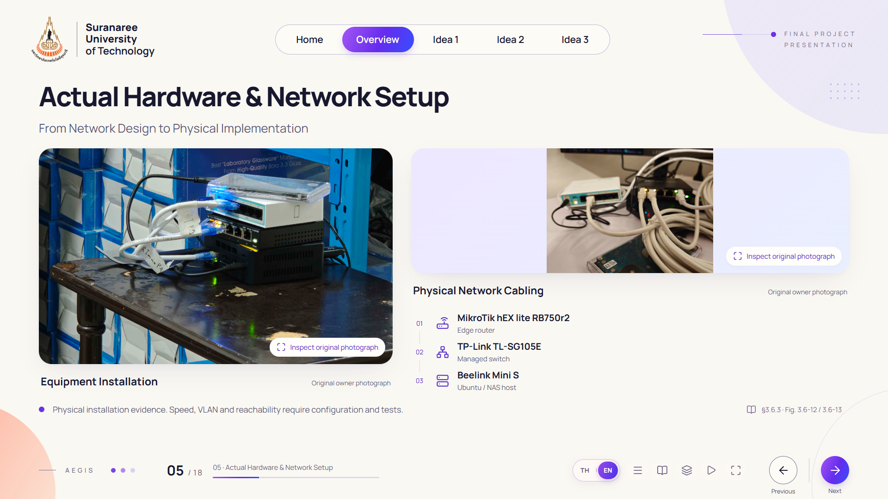 | 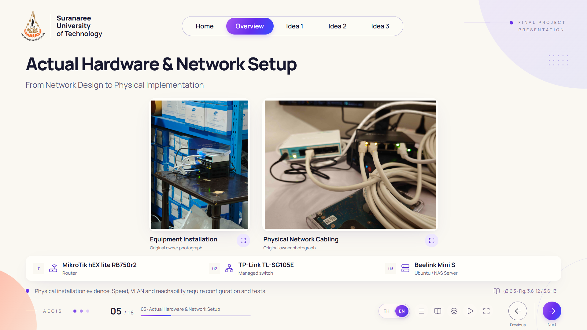 |
| Drive demo · TH | 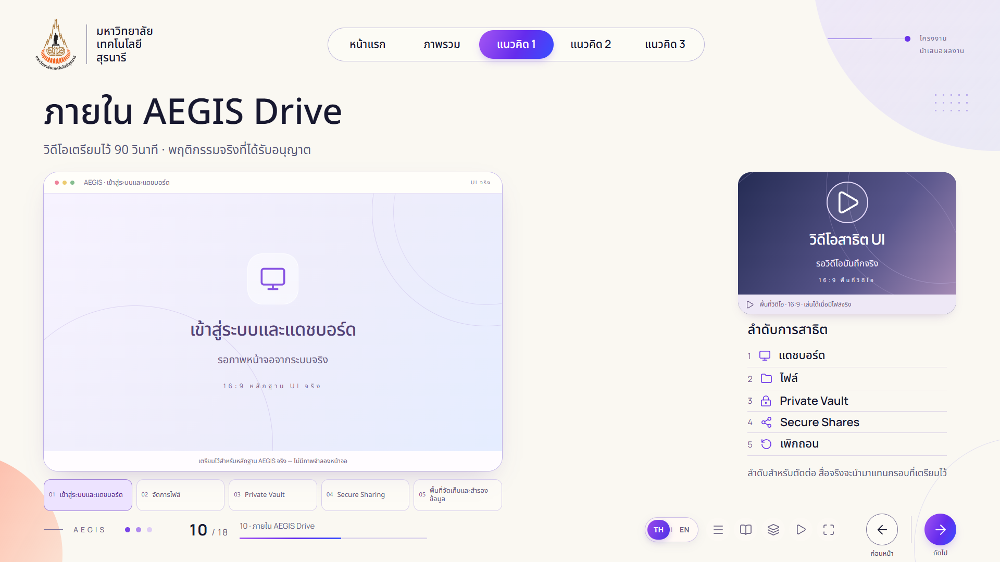 |  |
| Drive demo · EN | 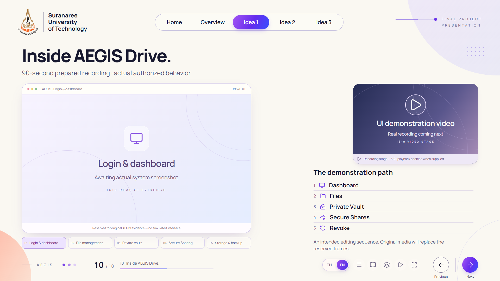 | 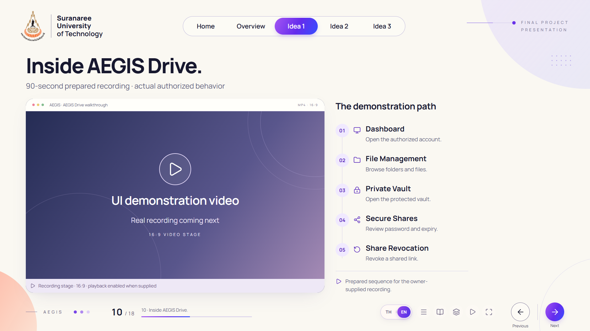 |
| Monitor demo · TH | 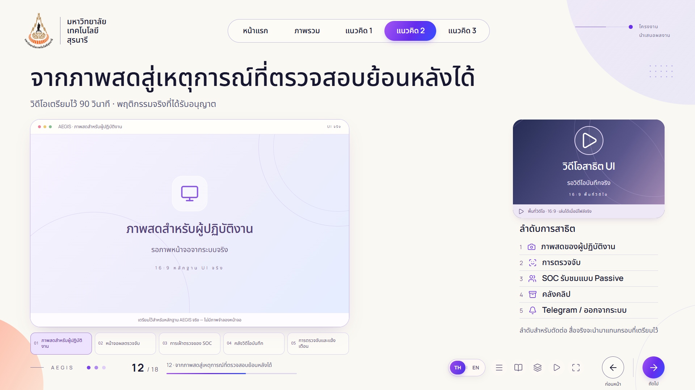 | 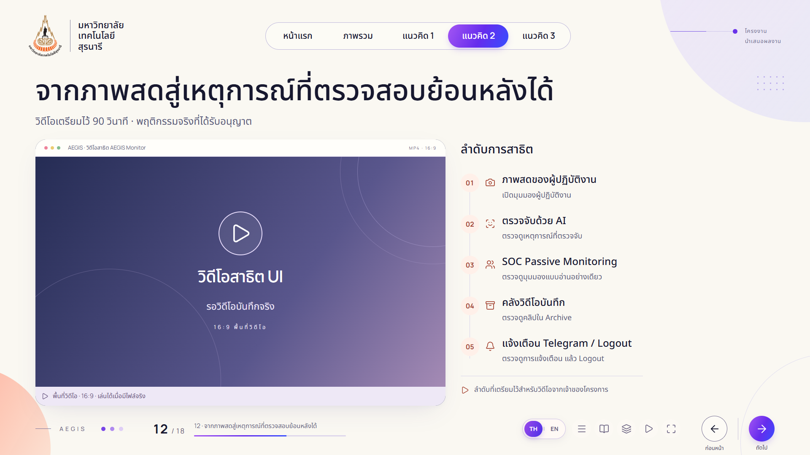 |
| Monitor demo · EN | 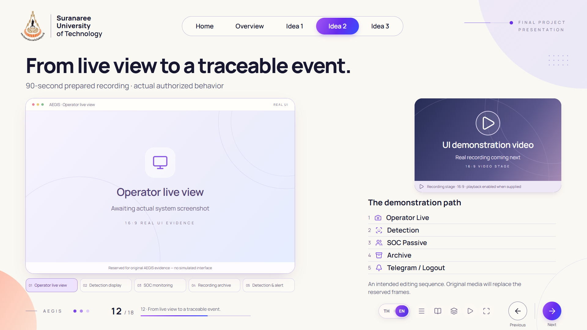 | 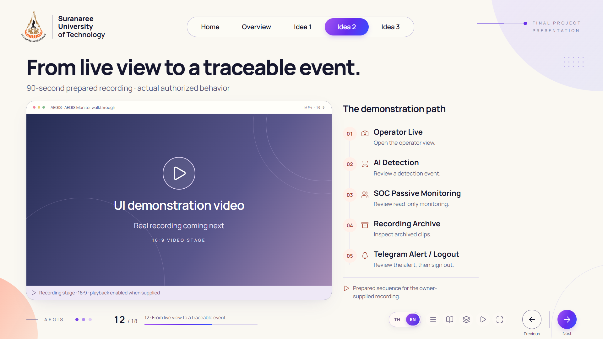 |

## Verified results

| Check | Result |
| --- | --- |
| `npm run check` | PASS — 18 scenes, 875 seconds, 24 manifest assets, 19 reserved missing assets |
| `npm run build` | PASS — Vite output `dist` |
| `PLAYWRIGHT_PORT=5193 npm test` | PASS — 25 tests, final run 58.3 seconds |
| 1920×1080 TH/EN | All 18 scenes fit; six target captures have no footer overlap or canvas overflow |
| Reading layouts | All scenes reflow at 390×844 in both languages; the hardware gallery is also captured at 1440×900 |
| Photo inspection | Both originals load at 3072×4096 / 4096×3072; keyboard opening, Escape restoration, reverse navigation, touch and missing-image fallback pass |
| Photo geometry | Rendered/native aspect ratios match; no horizontal viewport gutters; hover leaves image width/height unchanged |
| Demo structure | Exactly one video frame per scene; five text steps; no screenshot gallery or media in the right panel |
| Supplied-media path | Neutral test-only MP4 exercises native decoding, pause, seek/currentTime, focus exit, end without scene advance, and scene-exit pause; source-error recovery passes |
| Print | Six browser-generated QA PDFs each contain one 16:9 page (1440×810 pt); Thai resources include Noto Sans Thai; missing videos stay as static placeholders |
| Real-media print path | Test-injected available video is hidden in print; an available poster or fallback appears instead |
| Navigation | Keyboard, chapter links, chooser, fullscreen, rapid navigation and reverse transitions pass |
| Accessibility | Representative TH/EN axe checks have no serious/critical violations; independent design/a11y review findings addressed |
| Impeccable layout scan | `[]` before and after; this layout-only scan does not claim a clean full-style detector |
| Diff hygiene | `git diff --check` passes |

The test MP4 and test poster are controlled fixtures, never presented as AEGIS evidence. Actual video codecs, audio, captions and recording content still require review when approved recordings arrive. Screen readers and physical device combinations have not been manually exercised.

## Original file integrity

Both hashes match the V3 provenance records and the files are absent from this Git diff:

| File | SHA-256 |
| --- | --- |
| `equipment-setup.png` | `D7C206C5FCF818C653AA92734AFA92577CA1CEFE85EE0D7CE41CDDF322DEFDB9` |
| `lan-cable-switch.png` | `CE18A7F4FEAD4E0F6340AC018BBA3FCF2302404FCC2CCDA60D663170C2053AD7` |

## Media replacement

The expected MP4 paths remain:

- `public/assets/videos/idea1/idea1-demo.mp4`
- `public/assets/videos/idea2/idea2-demo.mp4`

Optional real posters remain `public/assets/screenshots/idea1/demo-poster.png` and the corresponding `idea2` path. Add the approved files and set their entries to `AVAILABLE` in `src/data/assets.ts`. No layout redesign is needed. Screenshot manifest entries are retained even though these two scenes now concentrate on recordings. See [ASSET_REQUESTS.md](../ASSET_REQUESTS.md).

An existing untracked `IDEA1-Drive.mp4` is preserved locally and excluded from this commit. It has not been renamed, wired into the manifest, or published.

## Reproduce

```powershell
npm run dev -- --port 5193 --strictPort
node scripts/capture-layout-refinement.mjs after
node scripts/verify-refinement-print.mjs
$env:PLAYWRIGHT_PORT='5193'
npm test
```

`verify-refinement-print.mjs` writes only ignored local QA PDFs; existing full-deck exports are unchanged. Screenshots use reduced motion for deterministic recording geometry. Ordinary/reverse entrances are tested separately.

## Owner review

- [x] The three requested layouts implemented and verified.
- [x] Before/after captures for both languages included.
- [x] Both original photographs unchanged.
- [x] Each demo has only one playable video when its asset is available.
- [ ] Owner approves the visual refinement.
- [ ] Owner supplies/approves actual recordings and posters, including captions/audio.
- [ ] Owner rehearses actual media on the presentation computer/projector.
- [ ] Owner authorizes merge and any Production deployment.
